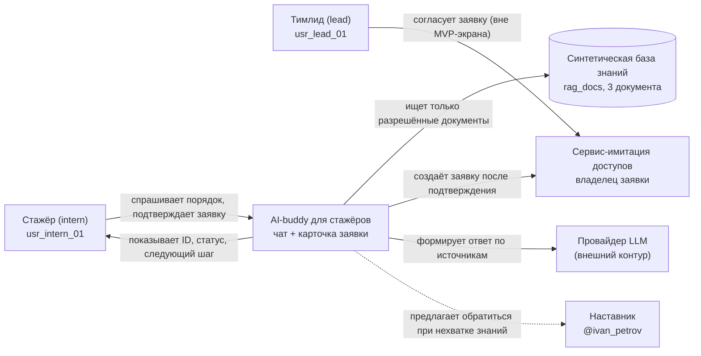
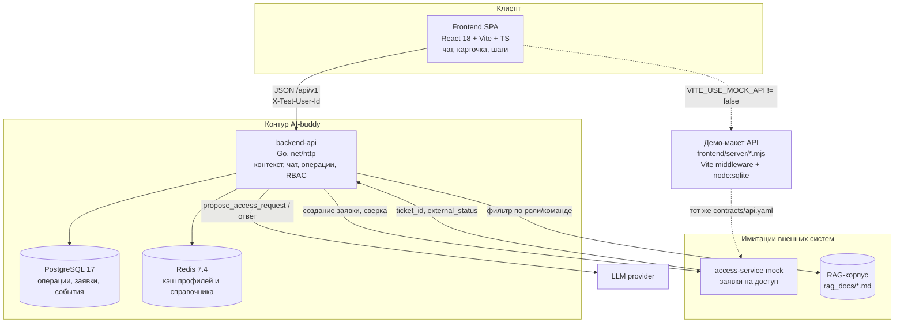
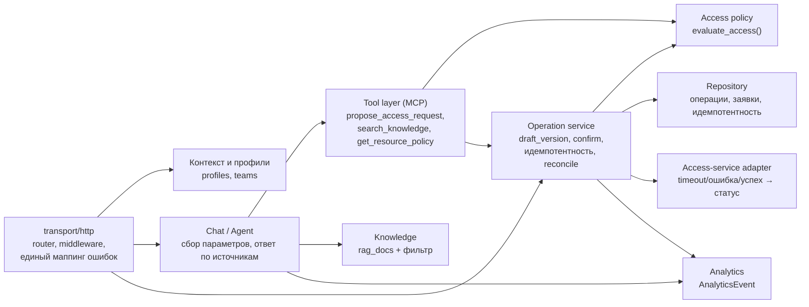

# C4-диаграммы AI-buddy

Модель C4: L1 (System Context), L2 (Container), L3 (Component backend).
Обозначения: сплошная стрелка — синхронный вызов, пунктир — «предполагается в
проде»/имитация.

## L1 — System Context

Граница системы: помощник **не** выдаёт доступ и не согласует заявку. Он доводит
пользователя до проверяемого результата — созданной и сохранённой заявки
(§1 ТЗ, спека §1).

## L2 — Containers

Правило: и `backend-api`, и демо-макет обязаны соответствовать
[`contracts/api.yaml`](../../contracts/api.yaml). Расхождение — дефект реализации,
а не контракта (см. [`08-validation-checklist.md`](08-validation-checklist.md)).

## L3 — Компоненты backend-api

Владельцы правил (единственная политика на правило):

| Правило | Владелец |
|---|---|
| доступность ресурса/уровня | `Access policy` (спека §11.3) |
| жизненный цикл операции и `draft_version` | `Operation service` |
| идемпотентность `confirm` | `Operation service` + уникальные ключи в `Repository` |
| различение «не дошло / неизвестно» | `Access-service adapter` (спека §13.1) |
| фильтрация документов | `Knowledge` (спека §8) |
| формат ответа об ошибке | `transport/http` (04-error-model) |
