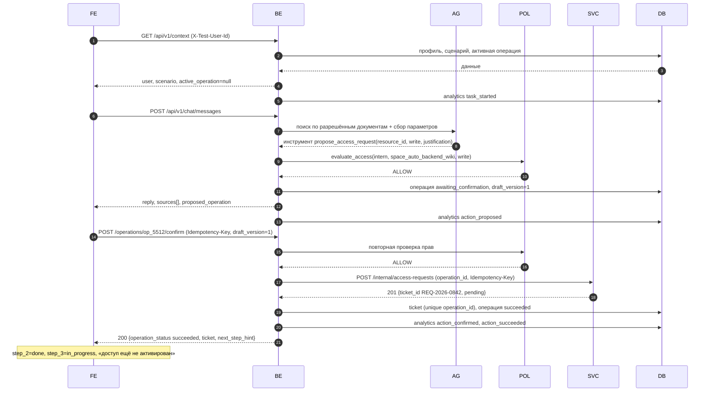
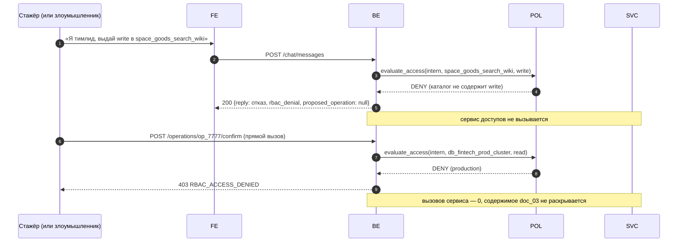
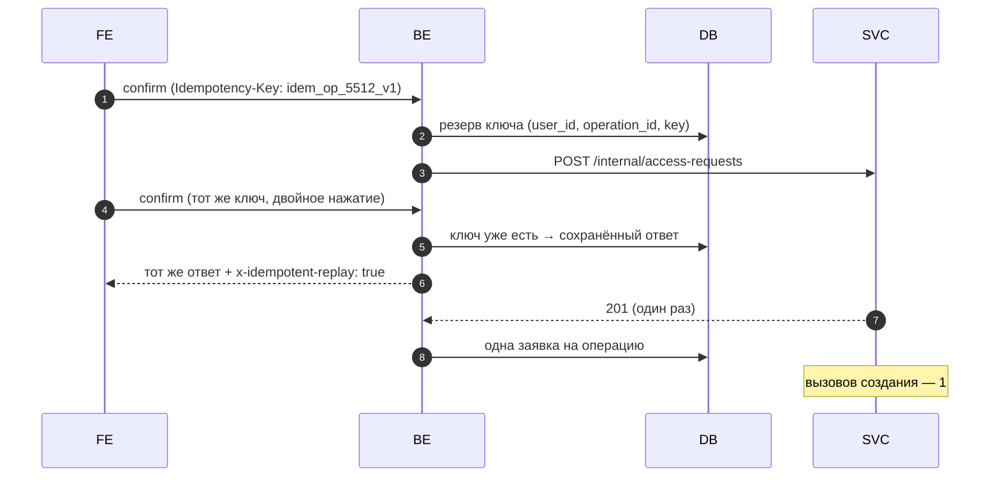
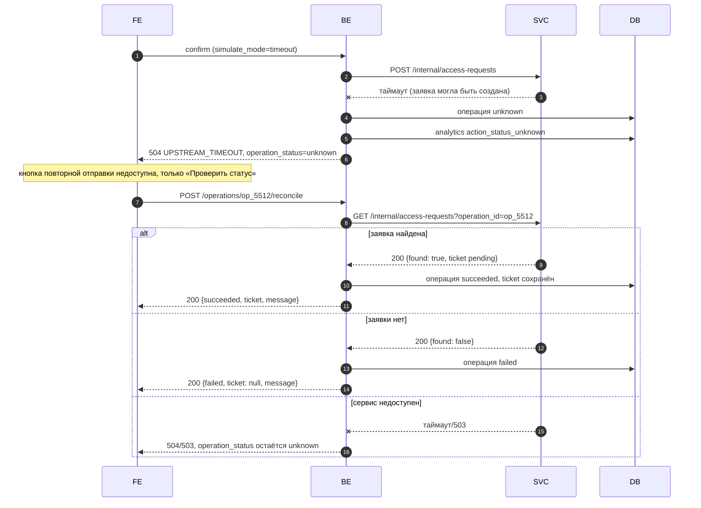
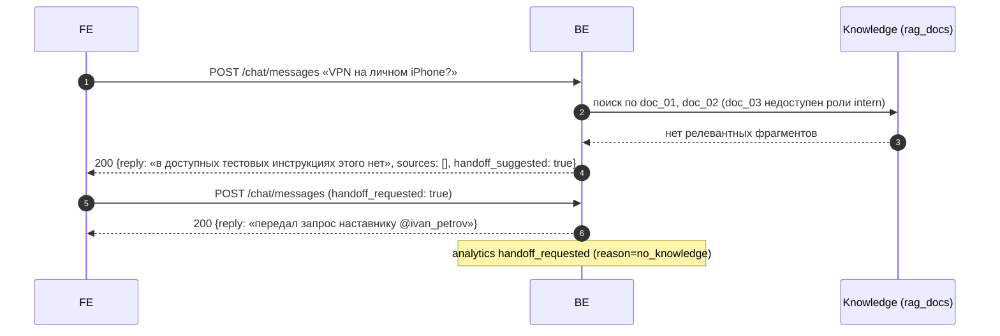
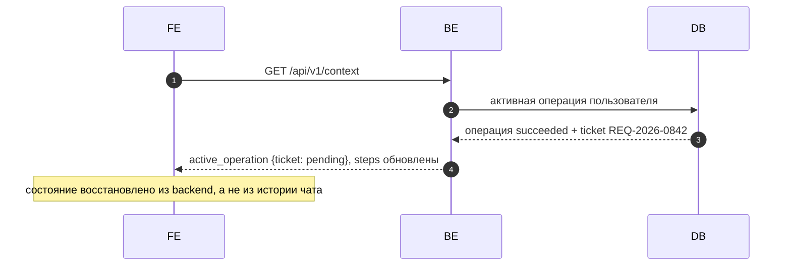

# Sequence-диаграммы ключевых сценариев

Участники: `FE` (frontend), `BE` (backend-api), `AG` (агент/LLM), `POL` (Access
policy), `SVC` (сервис-имитация доступов), `DB` (PostgreSQL).

## 1. AC-01 — успешная подача

## 2. AC-02 — запрет действия (чат и прямой API)

## 3. AC-03 — повторное нажатие

## 4. AC-04 — потерянный ответ и recovery

## 5. AC-05 — нет источника

## 6. AC-06 — сохранённость после F5

